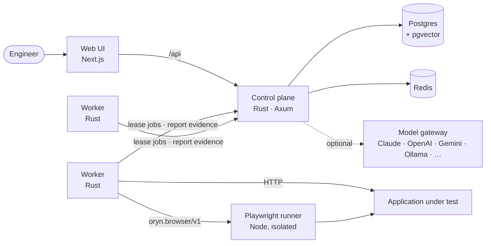

<div align="center">

# ORYN

**Build. Verify. Deliver.**

Self-hosted, open-source quality engineering with AI that reasons and a Rust engine that proves.

[](https://github.com/oryn-dev/oryn/actions/workflows/ci.yml)
[](LICENSE)
[](https://www.rust-lang.org/)
[](https://nextjs.org/)
[](https://playwright.dev/)
[](docs/DEPLOYMENT.md)
[](https://claude.com/claude-code)
[](CONTRIBUTING.md)

*AI reasons. Rust executes. Evidence proves. Humans govern.*

</div>

---

ORYN turns requirements and source code into executable Gherkin scenarios, runs them on
browser and API workers you host, and explains failures from recorded evidence. Models
help plan and interpret; they never decide whether a test passed. Every verdict comes
from assertions the Rust execution engine checked, and every AI suggestion waits for a
human to approve it.

It works fully without any AI provider. Plug in Anthropic Claude, OpenAI, Azure OpenAI,
Gemini, Ollama or any OpenAI-compatible endpoint when you want help.

## What it does

| Area | What you get |
| --- | --- |
| **Projects** | Import a repository (Git, GitHub, GitLab, ZIP or a local path). ORYN detects languages, frameworks, dependencies, routes (Express, Next.js, FastAPI, Flask, Spring, Axum, OpenAPI), tests and modules, and tracks what changed between analyses. |
| **Requirements & traceability** | Import user stories from Markdown, link them to scenarios by tag (`@US-4`) or by hand, and see which requirements are covered, verified or failing. |
| **Test Studio** | Write Gherkin in an editor with live validation against a closed step library for browser and API testing. Approve scenarios before they can run. Record browser sessions into Gherkin with passwords redacted. |
| **AI Test Planner** | Generate a test plan from requirements and code context, heuristically (no AI) or with your model. Review, edit, approve or reject each scenario. Nothing runs until a person approves it. |
| **Executions** | Run suites on remote workers in parallel with retries, cancellation and live progress. Every step records expected and actual values, screenshots, logs and network traffic. |
| **Failure investigation** | Deterministic rules classify each failure (application defect, test defect, environment, dependency, auth, flaky) from observations. An optional, clearly labelled AI interpretation explains what they likely mean. |
| **Quality intelligence** | Pass rate, flakiness, coverage, trends and recommendations with [documented formulas](docs/METRICS.md). Regression selection ranks the scenarios a change most likely affects. |
| **Execution fabric** | Stateless Rust workers lease jobs from a Postgres queue and delegate browsers to an isolated Playwright runner. Scale by adding workers. |
| **Governance** | Workspaces, teams, roles, project-level access, OIDC single sign-on, API tokens with role ceilings, an audit log, encrypted credentials and SSRF protection. |

## Quick start

You need Docker with Compose.

```bash
git clone https://github.com/oryn-dev/oryn.git
cd oryn
cp .env.example .env    # set ORYN_SECRET_KEY before exposing anything
make up                 # builds and starts everything, then seeds the demo project
```

Open <http://localhost:3000> and sign in as `admin@oryn.local` / `oryn-demo-password`.
The seeded **Northwind Supply** project has requirements, six suites and a demo
application with three planted defects. Run a suite from Test Studio and watch ORYN find
them.

Prefer running from source? See [docs/DEVELOPMENT.md](docs/DEVELOPMENT.md):

```bash
make install && make dev   # API :8080, web :3000, runner :7400, demo app :4000
make demo                  # seed, then run every demo suite
```

## How it fits together



- **Control plane** (`crates/oryn-api`): REST API with OpenAPI docs at `/api/docs`, auth,
  RBAC, the job queue, intelligence and the model gateway.
- **Workers** (`crates/oryn-worker`): lease `oryn.job/v1` jobs, run API steps natively and
  browser steps through the runner, upload evidence, report deterministic results.
- **Playwright runner** (`adapters/playwright-runner`): a small HTTP service that executes
  primitive browser steps; it has no business logic.
- **Engines**: Gherkin compiler (`oryn-bdd`), API engine (`oryn-api-engine`), execution
  engine (`oryn-execution`), repository and failure intelligence (`oryn-intelligence`).

Read more in [docs/ARCHITECTURE.md](docs/ARCHITECTURE.md).

## Principles

1. **A model never declares a test successful.** Verdicts come only from deterministic
   execution evidence.
2. **A model never gets a shell, filesystem or host access.** It receives redacted,
   fenced context and must answer in a validated schema.
3. **Humans approve.** AI-planned scenarios, and any change they imply, need explicit
   approval. ORYN never edits your application code.
4. **Secrets stay secret.** Credentials are encrypted at rest, handed only to the worker
   running the job, and redacted from logs and evidence.
5. **Useful without AI.** Planning, investigation and recommendations all have
   deterministic paths.

## Documentation

| | |
| --- | --- |
| [Product spec](docs/PRODUCT_SPEC.md) | What ORYN is for and how it works |
| [Architecture](docs/ARCHITECTURE.md) | Components, protocols, queue, lifecycle |
| [Data model](docs/DATA_MODEL.md) | Tables and tenancy |
| [API](docs/API_SPEC.md) | Conventions and endpoint inventory |
| [Metrics](docs/METRICS.md) | Every formula behind every figure |
| [Security](docs/SECURITY.md) | Threat model and controls |
| [Development](docs/DEVELOPMENT.md) | Running, testing, contributing code |
| [Deployment](docs/DEPLOYMENT.md) | Compose, Kubernetes, production checklist |
| [Implementation status](docs/IMPLEMENTATION_STATUS.md) | What is built and how it was verified |
| [Decisions](docs/decisions/) | Architecture decision records |
| [Browser protocol](docs/protocol/browser-v1.md) | `oryn.browser/v1` |
| [Design system](design.md) | The UI's locked design system |

## Community

ORYN is built in the open for the quality-engineering community.

- **Contribute**: start with [CONTRIBUTING.md](CONTRIBUTING.md). Good first areas are
  step-library additions, route detectors for more frameworks, and model providers.
- **Report a bug or request a feature**: open an issue with what you expected and what
  happened.
- **Security issues**: please report privately, see [SECURITY.md](SECURITY.md).
- **Conduct**: everyone taking part follows the [code of conduct](CODE_OF_CONDUCT.md).

## Built with Claude

ORYN was designed and implemented with [Claude Code](https://claude.com/claude-code),
Anthropic's agentic coding tool, working from a written product specification under
human direction. Claude wrote the Rust services, the web UI, the tests and these docs;
every capability listed as verified in
[docs/IMPLEMENTATION_STATUS.md](docs/IMPLEMENTATION_STATUS.md) was checked by running
it. ORYN's own AI features default to Claude models through the model gateway, but any
supported provider, or none, works.

## Licence

[Apache License 2.0](LICENSE). Copyright 2026 the ORYN contributors.
