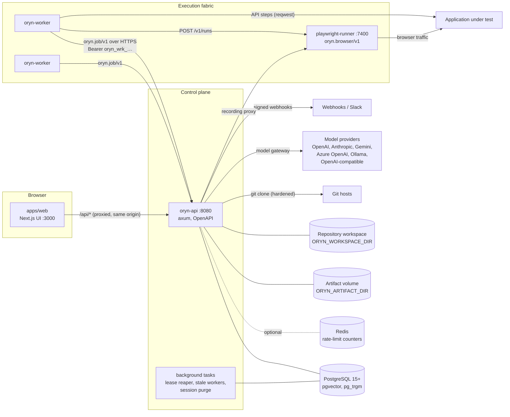
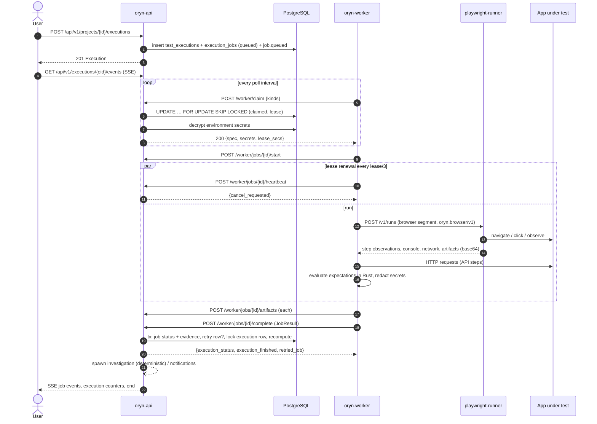

# Architecture

This document describes how ORYN is built, as implemented in this repository. It is derived from the code; where a capability is planned but absent it says "not implemented". The product view is in [PRODUCT_SPEC.md](PRODUCT_SPEC.md), the tables in [DATA_MODEL.md](DATA_MODEL.md), the HTTP surface in [API_SPEC.md](API_SPEC.md), and the security controls in [SECURITY.md](SECURITY.md).

The design rule behind every component is the project's philosophy: **AI reasons. Rust executes. Evidence proves. Humans govern.** Concretely:

- Test verdicts are computed by deterministic Rust code from observations; no model output can set or change a pass/fail result.
- Models only produce proposals (test plans) and labelled interpretations (failure investigations). Proposals are compiled against a closed step library and need human approval before they can run.
- Models have no tool use, no shell and no filesystem access. The gateway sends text and receives text/JSON.
- Every component works with no model configured.

## Components



| Component | Location | Responsibility |
|---|---|---|
| Web UI | [`apps/web`](../apps/web) | Next.js app (standalone output). Proxies `/api/*` and `/healthz` to `ORYN_API_INTERNAL_URL` so the session cookie stays first-party ([`next.config.ts`](../apps/web/next.config.ts)). API types are generated from the OpenAPI document. |
| Control plane | [`crates/oryn-api`](../crates/oryn-api) | The only component with database access. Authentication, RBAC, all REST endpoints, the worker protocol, the job queue, repository import/analysis (background tasks), the model gateway calls, notifications, artifact storage, and background maintenance. Migrates the database on start. |
| Worker | [`crates/oryn-worker`](../crates/oryn-worker) | Stateless process with no inbound ports and no database access. Leases jobs over HTTP, runs them with the Rust `ScenarioRunner`, uploads artifacts, reports results, renews leases. |
| Playwright runner | [`adapters/playwright-runner`](../adapters/playwright-runner) | Node/TypeScript HTTP service speaking [`oryn.browser/v1`](protocol/browser-v1.md). Executes primitive browser actions and reports observations; never decides pass/fail. Also hosts the headed session recorder. |
| PostgreSQL | `pgvector/pgvector:pg17` in compose | All state, including the job queue. Extensions `vector` and `pg_trgm` are created by the migration. |
| Redis | `redis:7-alpine` in compose | Optional. Shared fixed-window rate-limit counters across API replicas. Without it the limiter uses in-process counters. Nothing else uses Redis. |

### Rust crates

| Crate | Responsibility |
|---|---|
| [`oryn-domain`](../crates/oryn-domain) | I/O-free vocabulary: string enums (roles, statuses, kinds), the role→permission matrix (`rbac.rs`), the executable step model `ExecStep` (`steps.rs`), and the job protocol types `JobSpec`/`JobResult` (`job.rs`). |
| [`oryn-observability`](../crates/oryn-observability) | `tracing` subscriber setup (`RUST_LOG`, `ORYN_LOG_FORMAT=json`) and optional OTLP/HTTP trace export. |
| [`oryn-auth`](../crates/oryn-auth) | Argon2 password hashing, random tokens and SHA-256 token hashes, AES-256-GCM `SecretBox`, HMAC-SHA256 webhook signatures, regex-based redaction (`redact.rs`). |
| [`oryn-db`](../crates/oryn-db) | SQLx (runtime queries, no compile-time DB) persistence: identity, projects, testing, execution queue, AI records, analytics, governance. Holds the migrations and the `oryn-migrate` binary. |
| [`oryn-artifacts`](../crates/oryn-artifacts) | `ArtifactStore` trait and the only implementation, `LocalArtifactStore` (filesystem). Name sanitising and key validation. |
| [`oryn-bdd`](../crates/oryn-bdd) | Gherkin parsing (the `gherkin` crate), the closed step library (`library.rs`), and compilation of features into `PlannedStep` lists with diagnostics. |
| [`oryn-api-engine`](../crates/oryn-api-engine) | REST test engine (`ApiSession`): requests, headers, variables, JSONPath and JSON Schema assertions, and the job `NetworkPolicy` (`policy.rs`). |
| [`oryn-execution`](../crates/oryn-execution) | `ScenarioRunner` (runs a `JobSpec`), the `oryn.browser/v1` client and observation evaluator (`browser.rs`), job lifecycle state machine, retry policy, and an in-memory queue for embedding. |
| [`oryn-model-gateway`](../crates/oryn-model-gateway) | Provider-neutral `Gateway` (redaction, retries, schema validation and repair, cost) and provider adapters. |
| [`oryn-intelligence`](../crates/oryn-intelligence) | Deterministic intelligence: static repository analysis, safe import (ZIP, git), heuristic and AI test planning, failure investigator, regression selection and recommendations. |
| [`oryn-api`](../crates/oryn-api) | The control-plane binary (see above). |
| [`oryn-worker`](../crates/oryn-worker) | The worker binary (see above). |

## Job protocol `oryn.job/v1`

Defined in [`crates/oryn-domain/src/job.rs`](../crates/oryn-domain/src/job.rs) (`JOB_PROTOCOL = "oryn.job/v1"`).

- `JobSpec` is what a worker receives: `protocol`, `job_id`, `execution_id`, `project_id`, `scenario_id`, `scenario_name`, `attempt`, `steps: Vec<PlannedStep>`, `environment: JobEnvironment`, `options: JobOptions`.
- `JobEnvironment`: `name`, `base_url`, `api_base_url`, `variables`, `secret_names` (names whose values must be redacted), `allowed_hosts` (empty means derived from the base URLs).
- `JobOptions`: `browser` (`chromium`/`firefox`/`webkit`), `step_timeout_ms` (default 10 000), `job_timeout_ms` (default 300 000), `screenshots` (`off`/`on_failure`/`every_step`), `record_video`, `record_trace`. The API sets browser, screenshots, video and trace from the run request; the two timeouts always use the defaults.
- `PlannedStep` = `index`, `keyword`, `text` (the Gherkin line), `step: ExecStep`.
- `JobResult` is what a worker reports: `status`, timestamps, `duration_ms`, `steps: Vec<StepResult>`, `logs`, `network`, `artifacts: Vec<ArtifactRef>`, `browser_version`, `error` (infrastructure error, distinct from an assertion failure).
- `StepResult` carries `status` (`passed`/`failed`/`skipped`/`error`), `observation`, `message`, `expected`, `actual`, `artifact`.
- `JobResult::status_from_steps`: any step `error` → job `error`; else any `failed` → `failed`; else `passed`.

The spec stored in `execution_jobs.spec` contains secret *names* only. Secret values are decrypted at claim time and returned beside the spec in the claim response (`secrets`), never stored in the spec.

### Worker endpoints

All under `/api/v1/worker`, authenticated with `Authorization: Bearer oryn_wrk_…` (see [API_SPEC.md](API_SPEC.md#worker-protocol)).

| Call | Purpose |
|---|---|
| `POST /register` | Self-register a shared worker with the instance bootstrap token; returns a worker token. |
| `POST /heartbeat` | Worker liveness, active job count, draining flag, capabilities, version/hostname/OS. |
| `POST /claim` | Lease the next queued job of the given kinds (`api`, `browser`, `mixed`). `204` when none. |
| `POST /jobs/{id}/start` | `claimed` → `running`. |
| `POST /jobs/{id}/heartbeat` | Renew the lease; response says whether cancellation was requested. |
| `POST /jobs/{id}/artifacts` | Upload one artifact (raw body, query `name`, `kind`, `content_type`). |
| `POST /jobs/{id}/complete` | Report the `JobResult`. The control plane records evidence, decides retries and recomputes the execution. |

## Queue design

The queue is the `execution_jobs` table in PostgreSQL ([`crates/oryn-db/src/execution.rs`](../crates/oryn-db/src/execution.rs)). There is no message broker.

**Claiming.** One statement selects the oldest eligible row and updates it:

```sql
WITH next AS (
  SELECT id FROM execution_jobs
  WHERE status = 'queued' AND not_before <= now() AND kind = ANY($3)
    AND ($2::uuid IS NULL OR workspace_id = $2)
  ORDER BY created_at FOR UPDATE SKIP LOCKED LIMIT 1)
UPDATE execution_jobs j SET status = 'claimed', worker_id = $1, claimed_at = now(),
  lease_until = now() + make_interval(secs => $4)
FROM next WHERE j.id = next.id RETURNING ...
```

`SKIP LOCKED` lets any number of workers and API replicas claim concurrently without double-claiming. A workspace worker (`execution_workers.workspace_id` set) claims only its workspace's jobs; a shared worker (`workspace_id IS NULL`, created through bootstrap registration) claims from every workspace. The same transaction writes a `job.claimed` event and moves the execution from `queued` to `running`. The partial index `execution_jobs_claim_idx (created_at) WHERE status = 'queued'` serves this query.

Not used for routing: worker `labels` are stored but never matched against jobs, and the requested browser is not matched against the worker's `browser:<name>` capabilities. A worker advertises `browser` and `mixed` kinds when its runner reports at least one available browser.

**Leases and heartbeats.** The lease length is `ORYN_JOB_LEASE_SECS` (default 60). The worker renews each job's lease every `lease_secs / 3` seconds via `POST /jobs/{id}/heartbeat`; a `409`/`404` there makes the worker stop the job. The worker process heartbeats every 15 s via `POST /heartbeat`.

**Reaper.** A background task in the API ([`crates/oryn-api/src/background.rs`](../crates/oryn-api/src/background.rs)) runs every 10 s:

1. `reap_expired_leases`: selects `claimed`/`running` jobs with `lease_until < now()` (`FOR UPDATE SKIP LOCKED`), marks them `timed_out` (or `cancelled` if cancellation was requested) with error `Worker lease expired (no heartbeat)`, emits `job.lease_expired`, and inserts a retry when `attempt < max_attempts` and no cancellation was requested. This path retries regardless of `retry_on_failure`, because a lost lease is an infrastructure error.
2. `mark_stale_workers_offline`: workers without a heartbeat for 90 s become `offline`.
3. Every 360th tick (about hourly): purge expired sessions.

Revoking a worker sets its in-flight jobs' `lease_until` to the past, so the next reaper pass retries them elsewhere.

**Retries as superseded rows.** A retry never mutates the failed row. `insert_retry` marks the old row `superseded = true` and inserts a new row with `attempt + 1`, the same spec (with `job_id`/`attempt` rewritten) and `not_before = now() + delay`. Every attempt's steps, logs, network and artifacts are kept; flaky detection reads that history. The retry decision on completion uses `RetryPolicy` ([`crates/oryn-execution/src/retry.rs`](../crates/oryn-execution/src/retry.rs)) with `backoff_ms = 2000`: `error` and `timed_out` are retried while `attempt < max_attempts`; `failed` only when the execution was started with `retry_on_failure`; delay is `2000 ms × 2^(attempt−1)`, capped at 60 s. `max_attempts` defaults to 2 and is clamped to 1–5.

**Execution row lock.** `complete_job` runs in one transaction: lock the job row (`FOR UPDATE`, owned by the worker), write status and evidence, replace `test_execution_steps`, emit `job.finished`, maybe insert a retry, then `recompute_execution`. `recompute_execution` first takes `SELECT 1 FROM test_executions WHERE id = $1 FOR UPDATE`. Concurrent completions in the same execution therefore serialise; under READ COMMITTED the counting statement that follows sees every job committed before the lock was granted. Without the lock, two simultaneous final completions could each miss the other and the execution would never reach a terminal state. Counters and status are derived from non-superseded rows only.

## Execution lifecycle

Job states ([`lifecycle.rs`](../crates/oryn-execution/src/lifecycle.rs)):

```text
queued ──claim──▶ claimed ──start──▶ running ──▶ passed | failed | error | timed_out
  │                 │                   │
  └──cancel─────────┴──────cancel───────┴──▶ cancelled
claimed/running ──lease expired──▶ timed_out (+ new queued retry row when attempts remain)
```

Execution status is recomputed from the final attempts: any job still `queued`/`claimed`/`running` → `running`; else any `failed` → `failed`; else any `error` or `timed_out` → `error`; else any `cancelled` → `cancelled`; else no jobs → `error`; else `passed`. `finished_at` and `duration_ms` are set when the execution first becomes terminal; only that transition triggers notifications.

**Starting a run** (`services/executions.rs::start`): select scenarios by `suite_id`, `scenario_ids` and/or `tags`; keep only *runnable* ones (executable, and `approved`, or `draft` when the workspace has `require_approval = false`); resolve the environment (given or the project default; error if none); build one `JobSpec` per scenario; insert the execution and all jobs in one transaction with a `job.queued` event each. At most 2000 scenarios per execution. Triggers are `manual`, `api`, `ci`, `schedule`, `regression`, `rerun`; a token-authenticated request without a trigger is recorded as `api`. The `schedule` value is accepted, but there is no scheduler (not implemented).

**Running** (`ScenarioRunner::run`, [`runner.rs`](../crates/oryn-execution/src/runner.rs)): steps run in order. Contiguous browser steps form a *segment* sent to the runner as one `POST /v1/runs` (one isolated browser context per segment). API steps run in `ApiSession`. Variables (`{{name}}`) are interpolated from environment variables, secrets and values stored by `I store the response JSON …`. The first failing step stops the scenario; the rest are `skipped`. Job timeout and cancellation are checked around each segment and step; partial evidence is always kept. Browser observations are turned into verdicts by `evaluate` in Rust; observations after a failed step in the same segment are downgraded to `skipped`. Secret values are redacted from step text, messages, actual values, observations, logs and the error before the result leaves the worker.

**Cancellation.** `POST /executions/{id}/cancel` cancels queued jobs immediately (`job.cancelled`) and sets `cancel_requested` on active ones (`job.cancel_requested`). The worker sees it on its next job heartbeat and cancels the run. On completion, a cancelled job with a non-`passed`/`failed` result is stored as `cancelled`, and no retry is scheduled.

**Events.** `job_events` rows (`job.queued`, `job.claimed`, `job.started`, `job.finished`, `job.retry_scheduled`, `job.cancelled`, `job.cancel_requested`, `job.lease_expired`) feed `GET /executions/{id}/events` (server-sent events, polled from the table every 0.8 s). There are no per-step events.

**After completion.** The API spawns an automatic investigation for a final `failed`/`error`/`timed_out` job, or for the failed earlier attempt when a scenario passed on retry (flagged as flaky). When the execution finished, it delivers `execution.finished` (and `execution.failed` when not passed) to matching integrations.



## Model gateway

[`crates/oryn-model-gateway`](../crates/oryn-model-gateway). The API resolves the workspace's default enabled provider and its default model (else the first model, else a built-in default per kind) in `AppState::ai`; `Ok(None)` means AI is not configured and callers fall back to deterministic behaviour.

- **Providers** ([`providers.rs`](../crates/oryn-model-gateway/src/providers.rs)): `anthropic` (Messages API, `output_config.format` JSON schema), `openai`, `azure_openai`, `openai_compatible` (one adapter; `response_format: json_schema`), `gemini`, `ollama`, and `mock` (deterministic replies keyed by request purpose, used in tests and CI). Keys are stored AES-GCM-encrypted in `ai_providers.api_key_encrypted`.
- **Redaction.** `Gateway::run` applies `oryn_auth::redact::redact` to the system prompt and every message before the first call.
- **Untrusted-content fencing.** Prompt builders wrap repository snippets, requirements, user planning instructions, observations and scenario source in `<untrusted source="…">…</untrusted>` (`untrusted()`), neutralising embedded `<untrusted`/`</untrusted` tags. Every system prompt starts with `SAFETY_PREAMBLE`, which tells the model to treat fenced content as data, not to follow instructions in it, and never to claim a test passed without evidence.
- **Structured outputs.** When a JSON schema is given it is sent to the provider, the reply is parsed (tolerating code fences) and validated with `jsonschema`. On a validation failure the gateway sends one repair turn containing the model's reply and the validation error; a second failure is `InvalidOutput`.
- **Retries.** Up to 3 attempts on `429`, `408`/`409`/`5xx` and network errors; backoff 800 ms × 2^(attempt−1), or the provider's `retry-after` capped at 30 s.
- **Usage recording.** `AppState::ai_call` writes an `ai_requests` row (provider, model, purpose, status, attempts, latency, error, user) and an `ai_usage` row (input/output tokens, cost from `ai_models` per-million-token prices) for successes and failures.
- **Purposes in use:** `test_plan`, `investigation`, and the provider connectivity test. Regression selection and recommendations do not call a model.

## Intelligence

[`crates/oryn-intelligence`](../crates/oryn-intelligence). Each module produces a result without a model.

- **Repository analysis** (`analysis.rs`): walks the tree without executing anything (skips vendored/build directories; caps 25 000 files, 1 MB read per file). Produces languages and line counts, frameworks, dependencies (npm, cargo, pypi, go, maven/spring-boot, rubygems, composer), routes (Express/Koa/Fastify/Hono, FastAPI/Flask, Spring, plain Node, axum, Next.js app/pages routers), OpenAPI documents, test and `.feature` files, docs, modules (by path prefix), per-file SHA-256 hashes, and a change set against the previous analysis. Text is chunked (1 600 chars, up to 2 000 chunks), redacted, and stored in `context_chunks` for PostgreSQL full-text search (`tsvector`). The `embedding` columns exist but are never written or queried (vector search is not implemented).
- **Planner** (`planner.rs`): `heuristic_plan` derives scenarios from acceptance criteria that name a page or endpoint and adds smoke scenarios for detected routes no requirement covers. `ai_plan_request` sends requirements, detected routes, up to 12 full-text-matched repository snippets and existing scenario names, with the full step-library text and a JSON schema. Both outputs are compiled against the step library (`validate`); invalid scenarios are kept but marked non-executable. Plans start as `draft` and become suites only on approval.
- **Investigator** (`investigator.rs`): `classify` extracts observations (failing step, job error, network, console, history) and applies ordered rules, first match wins: `flaky.retry_or_flips` → `environment.unreachable` → `auth.rejected` → `dependency.upstream_error` → `test.target_missing` → `app.server_error` → `app.assertion_mismatch` → `environment.step_error` → `fallback` (`unknown`). Each rule sets a category, confidence, summary, root cause and suggested checks. The optional AI interpretation receives only the observations, the rule result and the scenario source (fenced), must match an interpretation schema, and is stored separately in `failure_investigations.interpretation` labelled `"AI interpretation"`. The stored `category` is the deterministic one unless that was `unknown`, in which case the model's category (constrained by the schema enum) is used; `deterministic_category` always keeps the rule result. The job's pass/fail status is never touched.
- **Regression** (`regression.rs`): scores runnable scenarios against changed files: +3 if the scenario exercises a route defined in a changed file, +2 if a keyword from a changed path appears in its name/suite/tags/steps, then +1 if it failed last time and +1 if flaky; untouched `@smoke` scenarios score 0.5 as a baseline. Default `min_score` 0.5. Changed files come from the request or from the last analysis change set. `recommendations` derives deterministic recommendations (coverage, verification, flaky, failing, performance, uncovered routes) stored in `ai_recommendations` with `source = 'heuristic'`. AI-sourced recommendations are not implemented (`insert_recommendation` exists but has no caller).
- **Import** (`import.rs`): validated ZIP extraction and hardened `git clone`; see [SECURITY.md](SECURITY.md).

## Authentication and authorisation

Implemented in [`crates/oryn-api/src/auth.rs`](../crates/oryn-api/src/auth.rs) and [`routes/auth.rs`](../crates/oryn-api/src/routes/auth.rs).

- **Sessions.** `POST /auth/login` or `/auth/register` sets `oryn_session` (`HttpOnly; SameSite=Lax; Path=/; Max-Age=TTL`, plus `Secure` when `ORYN_COOKIE_SECURE=true`). Only the SHA-256 of the token is stored (`sessions.token_hash`). TTL `ORYN_SESSION_TTL_HOURS` (default 168).
- **CSRF.** A cookie-authenticated request with a method other than `GET`/`HEAD`/`OPTIONS` must carry the `x-oryn-csrf` header (any value); a cross-site form cannot set custom headers. Bearer-token requests are exempt.
- **API tokens.** `Authorization: Bearer oryn_pat_…`, hashed at rest, scoped to one workspace with a role. The effective role is the lower of the token's role and the user's current membership role (a *role ceiling*). Tokens cannot mint tokens, cannot create workspaces, and a token's role cannot exceed its creator's role. Optional expiry; revocation is immediate.
- **OIDC.** Authorization code with PKCE (S256), `state` and `nonce` stored in `oidc_states` for 15 minutes. Discovery via `{issuer}/.well-known/openid-configuration`; the user is identified from the `userinfo` endpoint (`sub`, `email`; `email_verified: false` is rejected). The ID token is not validated and the nonce is not checked against it. A new OIDC user is linked to an existing account with the same email, or created with a personal workspace.
- **RBAC.** Four roles (owner, admin, engineer, viewer) and 16 permissions; the matrix is static in `oryn-domain/src/rbac.rs` and mirrored as reference data in the database. Every handler resolves a `WsCtx` or `ProjectCtx` and calls `require(Permission)`.
- **Project access.** Workspace owners/admins get their workspace role on every project. For other members: workspace-visible projects use the higher of the workspace role and any project grant (user or team); `private` projects require an explicit grant. Non-members get `404`, not `403`. (See the discrepancy about `private` vs `restricted` in [SECURITY.md](SECURITY.md#known-limitations).)

## Observability

- Logs: `tracing` with `RUST_LOG` filtering (default `info`); `ORYN_LOG_FORMAT=json` for JSON lines with the current span. The compose file sets JSON.
- Traces: when `OTEL_EXPORTER_OTLP_ENDPOINT` is set, spans are exported over OTLP/HTTP to `{endpoint}/v1/traces` with service names `oryn-api` and `oryn-worker`.
- Requests: every request gets an `x-request-id` (generated if absent, propagated to the response) and an `http` span with method, path and request id. `Authorization` and `Cookie` are marked sensitive.
- Health: `GET /healthz` (liveness: status, version, uptime) and `GET /readyz` (database and Redis reachability, rate-limit backend; `503` when the database is down).
- Metrics endpoints (Prometheus or similar): not implemented.
