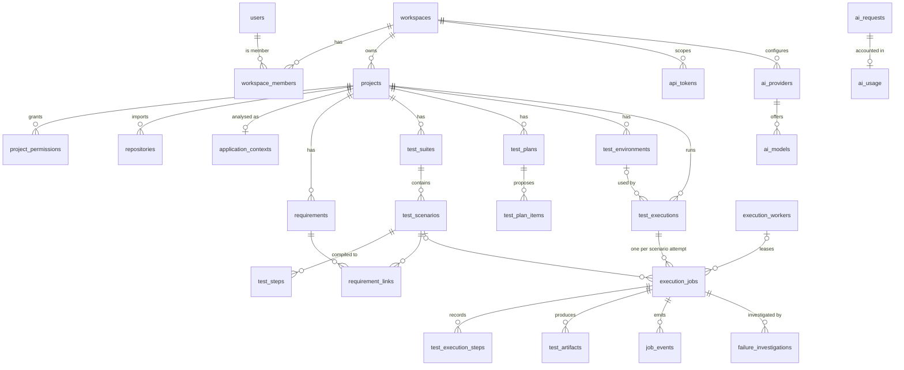

# Data model

The schema is defined by a single migration, [`crates/oryn-db/migrations/0001_initial.sql`](../crates/oryn-db/migrations/0001_initial.sql), applied by `oryn-api` on start or by `oryn-migrate` (see [DEPLOYMENT.md](DEPLOYMENT.md#upgrades-and-migrations)). Queries live in [`crates/oryn-db/src`](../crates/oryn-db/src).

## Conventions

- Primary keys are `uuid` generated by the application (`oryn_db::new_id()` = UUIDv7, so ids sort by creation time). Exceptions: `job_events.id` and `audit_events.id` are `bigserial`; `oidc_states` is keyed by `state`; reference tables are keyed by name.
- All timestamps are `timestamptz`.
- Enumerations are `text` with `CHECK` constraints that mirror `oryn-domain` enums.
- Soft deletion (`deleted_at`) on user-facing aggregates: `users`, `workspaces`, `projects`, `requirements`, `test_suites`, `test_scenarios`. Unique indexes on those tables are partial (`WHERE deleted_at IS NULL`).
- JSONB holds evidence blobs, analysis snapshots and provider-specific config that are read whole and not filtered in SQL.
- Extensions: `vector` (pgvector) and `pg_trgm` are created by the migration. The `vector` columns (`context_chunks.embedding`, `requirements.embedding`) are never written or read by the code; `pg_trgm` has no index using it.

## Tenancy rules

- The **workspace** is the tenant boundary. Every project-scoped row reaches its workspace through `project_id → projects.workspace_id`; execution, job, AI and governance tables also carry `workspace_id` directly.
- Isolation is enforced in the API layer, not with row-level security: each handler resolves the caller's membership (`workspace_members`) and project access (`project_permissions`, project `visibility`) before calling `oryn-db`, and project-scoped queries filter by the project id they were given ([`crates/oryn-db/src/lib.rs`](../crates/oryn-db/src/lib.rs)).
- Cross-workspace rows: `users` (global accounts), `execution_workers` with `workspace_id IS NULL` (shared workers), `audit_events` with `workspace_id IS NULL` (login events, shared-worker registration).
- Deleting a workspace or project cascades (`ON DELETE CASCADE`) to everything under it. The API soft-deletes projects (`deleted_at`); no hard-delete path exists in the API.

## Core entity-relationship diagram

## Identity and access

| Table | Key columns | Constraints and indexes | Notes |
|---|---|---|---|
| `users` | `id`, `email`, `name`, `password_hash` (Argon2, null for OIDC-only), `oidc_issuer`, `oidc_subject`, `is_instance_admin`, `deleted_at` | `users_email_uq` unique on `lower(email)` where not deleted; `users_oidc_uq` unique `(oidc_issuer, oidc_subject)` where subject not null | The first registered user becomes instance admin. |
| `sessions` | `user_id` → users, `token_hash` (SHA-256), `user_agent`, `ip`, `last_seen_at`, `expires_at` | `token_hash` unique; index on `user_id` | Expired sessions are purged hourly. |
| `oidc_states` | `state` (PK), `nonce`, `pkce_verifier`, `redirect_to`, `created_at` | | Single-use (deleted on callback), valid 15 minutes. |
| `workspaces` | `name`, `slug`, `require_approval` (default `true`), `created_by`, `deleted_at` | `workspaces_slug_uq` unique on `slug` where not deleted | `require_approval = false` lets `draft` scenarios run. |
| `roles` | `name` (PK, `owner`/`admin`/`engineer`/`viewer`), `rank`, `description` | | Reference data seeded by the migration. |
| `permissions` | `name` (PK), `description` | | 16 rows seeded. |
| `role_permissions` | `(role, permission)` PK | FKs to `roles`, `permissions` | Seeded; mirrors `Role::permissions()` in `oryn-domain`. The API enforces the Rust matrix. |
| `workspace_members` | `(workspace_id, user_id)` PK, `role` → roles | index on `user_id` | |
| `teams` | `workspace_id`, `name`, `description` | unique `(workspace_id, name)` | |
| `team_members` | `(team_id, user_id)` PK | | |
| `api_tokens` | `workspace_id`, `user_id`, `name`, `token_hash`, `role` → roles, `last_used_at`, `expires_at`, `revoked_at` | `token_hash` unique | Role is a ceiling; see [SECURITY.md](SECURITY.md). |

## Projects, repositories and requirements

| Table | Key columns | Constraints and indexes | Notes |
|---|---|---|---|
| `projects` | `workspace_id`, `name`, `slug`, `description`, `visibility`, `color`, `created_by`, `deleted_at` | `visibility` CHECK in (`workspace`, `restricted`); `projects_slug_uq` unique `(workspace_id, slug)` where not deleted | The API writes `private`, which this CHECK rejects; see [Discrepancies](#discrepancies). |
| `project_permissions` | `project_id`, `user_id` *or* `team_id`, `role` | CHECK exactly one of `user_id`/`team_id`; index on `project_id` | Project-level grants. |
| `repository_connections` | `workspace_id`, `kind` (`github`/`gitlab`), `name`, `base_url`, `token_encrypted` | | Token is AES-GCM sealed. |
| `repositories` | `project_id`, `connection_id` → connections (`SET NULL`), `source` (`github`/`gitlab`/`git`/`zip`/`local`), `url`, `default_branch`, `local_path`, `last_commit`, `status` (`pending`/`importing`/`ready`/`analyzing`/`failed`), `error`, `size_bytes`, `file_count`, `last_analyzed_at` | index on `project_id` | `local_path` is under `ORYN_WORKSPACE_DIR`, or the in-place directory for `local` imports. |
| `application_contexts` | `project_id` (unique), `repository_id`, `version`, `summary`, `analysis` (JSONB snapshot), `file_hashes` (JSONB path→sha256), `commit_sha`, `analyzed_at`, `files_changed_last_run` | one row per project | Latest analysis; `file_hashes` drives the change set. |
| `application_modules` | `project_id`, `name`, `path_prefix`, `kind`, `description`, `file_count` | unique `(project_id, path_prefix)` | Replaced on each analysis. |
| `context_chunks` | `project_id`, `source_path`, `content`, `tsv` (generated `to_tsvector('english', content)`), `embedding vector` | index on `project_id`; GIN on `tsv` | Redacted text chunks for full-text retrieval by the planner and `/context/search`. |
| `requirements` | `project_id`, `key`, `title`, `body`, `kind` (`requirement`/`user_story`/`acceptance_criteria`/`document`/`api_spec`), `source`, `parent_id` (self), `module_id`, `priority` (`low`..`critical`), `embedding`, `deleted_at` | `requirements_key_uq` unique `(project_id, key)` where not deleted | |
| `requirement_links` | `(requirement_id, scenario_id)` PK, `source` (`manual`/`tag`/`ai`/`plan`) | index on `scenario_id` | `tag` links come from scenario tags equal to a requirement key (e.g. `@REQ-3`); `plan` links from plan approval. `ai` is never written. |

## Testing

| Table | Key columns | Constraints and indexes | Notes |
|---|---|---|---|
| `test_suites` | `project_id`, `name`, `description`, `path`, `feature_source` (Gherkin text), `tags`, `parse_error`, `deleted_at` | index on `project_id` where not deleted | One suite = one feature file. |
| `test_scenarios` | `suite_id`, `project_id`, `name`, `tags`, `kind` (`browser`/`api`/`mixed`), `status` (`draft`/`approved`/`archived`), `origin` (`manual`/`ai`/`heuristic`/`recording`/`import`), `line`, `outline`, `example_index`, `executable`, `diagnostics`, `position`, `deleted_at` | indexes on `suite_id` and `project_id` where not deleted | Re-saving a suite matches scenarios by name; removed ones are soft-deleted. |
| `test_steps` | `scenario_id`, `position`, `keyword`, `text`, `step` (JSONB `ExecStep`) | unique `(scenario_id, position)` | The compiled, executable form. |
| `step_definitions` | `project_id`, `phrase`, `description`, `body` | unique `(project_id, phrase)` | Composite steps; validated on create but not used by the compiler (see [Discrepancies](#discrepancies)). |
| `test_data` | `project_id`, `name`, `description`, `data` (JSONB) | unique `(project_id, name)` | |
| `test_environments` | `project_id`, `name`, `base_url`, `api_base_url`, `allowed_hosts`, `variables` (JSONB), `secrets` (JSONB name→sealed value), `is_default` | unique `(project_id, name)` | `secrets` values are never returned by the API. |
| `test_plans` | `project_id`, `title`, `objective`, `input`, `status` (`draft`/`approved`/`rejected`), `source` (`ai`/`heuristic`/`manual`), `rationale`, `risk_analysis`, `coverage_gaps`, `ai_request_id`, `created_by`, `approved_by`, `approved_at` | index `(project_id, created_at DESC)` | `ai_request_id` has no FK. |
| `test_plan_items` | `plan_id`, `position`, `title`, `category`, `priority`, `risk`, `rationale`, `requirement_keys`, `gherkin`, `executable`, `diagnostics`, `status` (`proposed`/`accepted`/`rejected`), `scenario_id` | `category` CHECK in (`functional`, `negative`, `boundary`, `edge_case`, `regression`, `integration`, `security`); index `(plan_id, position)` | The planners emit `smoke` (and the AI schema allows `accessibility`), which this CHECK rejects; see [Discrepancies](#discrepancies). |
| `recordings` | `project_id`, `runner_recording_id`, `url`, `status` (`recording`/`stopped`/`converted`/`failed`), `events` (JSONB) | | Browser recorder sessions. |

## Execution

| Table | Key columns | Constraints and indexes | Notes |
|---|---|---|---|
| `execution_workers` | `workspace_id` (null = shared), `name`, `token_hash`, `status` (`online`/`offline`/`draining`/`revoked`), `version`, `hostname`, `os`, `concurrency`, `labels`, `active_jobs`, `last_heartbeat_at`, `registered_at`, `revoked_at` | `token_hash` unique | `labels` are stored, not used for routing. |
| `worker_capabilities` | `(worker_id, capability)` PK, `version`, `available` | | e.g. `api`, `browser:chromium`; replaced on heartbeat. |
| `test_executions` | `workspace_id`, `project_id`, `environment_id` (`SET NULL`), `environment_name`, `suite_id`, `title`, `status` (`queued`/`running`/`passed`/`failed`/`error`/`cancelled`), `trigger` (`manual`/`ci`/`api`/`rerun`/`schedule`/`regression`), `browser`, `rerun_of` (self), `commit_sha`, `branch`, `triggered_by`, counters `total`/`passed`/`failed`/`errored`/`cancelled`, `created_at`, `started_at`, `finished_at`, `duration_ms` | indexes `(project_id, created_at DESC)`, `(workspace_id, created_at DESC)`, partial `(status) WHERE status IN ('queued','running')` | Counters count final (non-superseded) attempts. |
| `execution_jobs` | `execution_id`, `workspace_id`, `project_id`, `scenario_id`, `scenario_name`, `kind`, `status` (`queued`/`claimed`/`running`/`passed`/`failed`/`error`/`cancelled`/`timed_out`), `attempt`, `max_attempts` (default 2), `retry_on_failure`, `spec` (JSONB `JobSpec`), `worker_id`, `lease_until`, `not_before`, `cancel_requested`, `superseded`, `claimed_at`, `started_at`, `finished_at`, `duration_ms`, `browser_version`, `error`, `logs` (JSONB), `network` (JSONB) | indexes on `execution_id`; partial claim index `(created_at) WHERE status = 'queued'`; partial lease index `(lease_until) WHERE status IN ('claimed','running')`; `(scenario_id, created_at DESC)` | The queue. One row per attempt; retries insert a new row and set `superseded` on the old one. `spec` holds secret names only. |
| `job_events` | `id` bigserial, `job_id`, `execution_id`, `kind`, `data`, `created_at` | index `(execution_id, id)` | Source of the SSE stream. |
| `test_execution_steps` | `job_id`, `execution_id`, `position`, `keyword`, `text`, `status` (`passed`/`failed`/`skipped`/`error`), `started_at`, `duration_ms`, `message`, `expected`, `actual`, `observation`, `artifact_name` | index `(job_id, position)` | Replaced on completion. |
| `test_artifacts` | `execution_id`, `job_id`, `project_id`, `name`, `kind` (`screenshot`/`video`/`trace`/`log`/`console`/`network`/`response`), `content_type`, `size_bytes`, `sha256`, `storage_backend` (default `local`), `storage_key` | unique `(job_id, name)`; index on `execution_id` | Bytes live in the artifact store under `<project>/<execution>/<job>/<name>`. |

## AI

| Table | Key columns | Constraints and indexes | Notes |
|---|---|---|---|
| `ai_providers` | `workspace_id`, `kind` (`openai`/`anthropic`/`gemini`/`azure_openai`/`ollama`/`openai_compatible`/`mock`), `name`, `base_url`, `api_key_encrypted`, `api_version`, `enabled`, `is_default` | unique `(workspace_id, name)` | |
| `ai_models` | `provider_id`, `name`, `context_window`, `input_cost_per_mtok`, `output_cost_per_mtok`, `supports_json`, `is_default` | unique `(provider_id, name)` | Prices drive cost estimates. |
| `ai_requests` | `workspace_id`, `project_id`, `provider_id`, `provider_kind`, `model`, `purpose`, `status` (`succeeded`/`failed`), `attempts`, `latency_ms`, `error`, `created_by` | index `(workspace_id, created_at DESC)` | One row per gateway call. Prompts and replies are not stored. |
| `ai_usage` | `request_id` → ai_requests, `workspace_id`, `input_tokens`, `output_tokens`, `cost_usd` | | |
| `failure_investigations` | `job_id`, `execution_id`, `project_id`, `category` (CHECK, 7 values), `deterministic_category`, `confidence`, `summary`, `probable_root_cause`, `observations` (JSONB: `rule`, `items`), `interpretation` (JSONB, null without AI), `suggested_investigation`, `suggested_remediation`, `ai_request_id`, `created_by` | index `(job_id, created_at DESC)` | Observations come from deterministic code; `interpretation` is the labelled AI output. |
| `ai_recommendations` | `project_id`, `kind`, `title`, `body`, `source` (`ai`/`heuristic`), `status` (`open`/`accepted`/`dismissed`), `related` | | Only `heuristic` rows are written. |

## Governance and integrations

| Table | Key columns | Constraints and indexes | Notes |
|---|---|---|---|
| `approvals` | `workspace_id`, `project_id`, `subject_type` (`scenario`, `test_plan`), `subject_id`, `status`, `requested_by`, `decided_by`, `decided_at`, `comment` | index `(subject_type, subject_id)` | Written when scenarios or plans are approved (record of the decision; there is no pending-approval workflow). |
| `audit_events` | `id` bigserial, `workspace_id`, `actor_kind` (`user`/`api_token`/`worker`/`system`), `actor_id`, `actor_label`, `action`, `subject_type`, `subject_id`, `data`, `ip` | index `(workspace_id, id DESC)` | Append-only from the API's point of view (no update/delete path). Writes are best-effort: a failed insert is logged, not raised. |
| `integrations` | `workspace_id`, `project_id` (optional scope), `kind` (CHECK allows `github`/`gitlab`/`jira`/`slack`/`github_actions`/`gitlab_ci`/`webhook`), `name`, `config`, `secret_encrypted`, `events` (default `{execution.completed}`), `enabled` | | The API creates only `webhook` and `slack`. Events used are `execution.finished` and `execution.failed`. |
| `integration_deliveries` | `integration_id`, `event`, `status_code`, `error`, `duration_ms` | index `(integration_id, created_at DESC)` | Delivery log. |

## Discrepancies

Found while documenting; the code was not changed.

1. **Project visibility.** The migration allows `visibility IN ('workspace','restricted')`, but the API validates and writes `workspace` or `private`, and access checks compare against `private`. Creating or updating a project with `visibility = "private"` violates the CHECK and fails with a `500`.
2. **Plan item categories.** `test_plan_items.category` allows `functional, negative, boundary, edge_case, regression, integration, security`. The heuristic planner emits `smoke` for uncovered detected routes, and the AI plan schema allows `smoke` and `accessibility`. Saving such a plan fails with a CHECK violation (`500`).
3. **Integration default events.** The column default is `{execution.completed}`, an event name the code never emits. The API always sets `events` explicitly, so the default is unused.
4. **Unused columns/tables.** `context_chunks.embedding` and `requirements.embedding` (pgvector) are never populated; `step_definitions` rows are not consulted by the Gherkin compiler; `requirement_links.source = 'ai'` and `ai_recommendations.source = 'ai'` are never written.
